# YotoBookMaker

A native macOS app for getting audio onto your [Yoto](https://yotoplay.com) player — split an audiobook into chapters, upload a folder of audio files directly as a playlist, or turn a podcast or live radio station into a streaming card.

> **Independent tool — not affiliated with or endorsed by Yoto Limited.**

 

Also available for **[Windows →](https://github.com/bbenkle/YotoBookMaker-Windows)**

---

## Download

Grab the latest release from the [Releases](../../releases) page, open the `.dmg`, and drag **YotoBookMaker** to your Applications folder.

---

## Requirements

- macOS 14 Sonoma or later
- A [Yoto account](https://my.yotoplay.com) (needed for uploading and for podcast and radio cards — you can split without one)
- An internet connection on the Yoto player for podcast and radio cards, since they stream

---

## Workflows

Pick a workflow on the welcome screen (**Choose Workflow** in the sidebar takes you back to it at any time). Each one has a step-by-step guide below.

| Workflow | Use it to | Yoto account | Guide |
|---|---|---|---|
| **Audiobook** | Split one audiobook into chapters, add icons, and upload it as a playlist (or just split it) | Only to upload | [Audiobook workflow →](#audiobook-workflow) |
| **Playlist** | Upload a folder of audio files as a playlist, no splitting needed | Yes | [Playlist workflow →](#playlist-workflow) |
| **Batch split** | Split a whole folder of audiobooks at once with shared settings | No | [Batch split workflow →](#batch-split-workflow) |
| **Podcast** | Make a card that streams episodes from a podcast, and refresh it later with new ones | Yes | [Podcast workflow →](#podcast-workflow) |
| **Radio** | Make a card that plays live radio stations | Yes | [Radio workflow →](#radio-workflow) |

**Also in this guide:** [Icons](#icons) · [Uploading to Yoto](#uploading-to-yoto) · [CLI tool](#cli-tool-yotosplit) · [Updates](#updates) · [Privacy](#privacy)

---

## Audiobook workflow

### 1 — Select your audiobook

Drop an audiobook file onto the window or click **Browse Files**. The book title and author are read automatically from the file's embedded metadata.

**Supported formats:** M4B · M4A · MP3 · MP4 · WAV · AAC

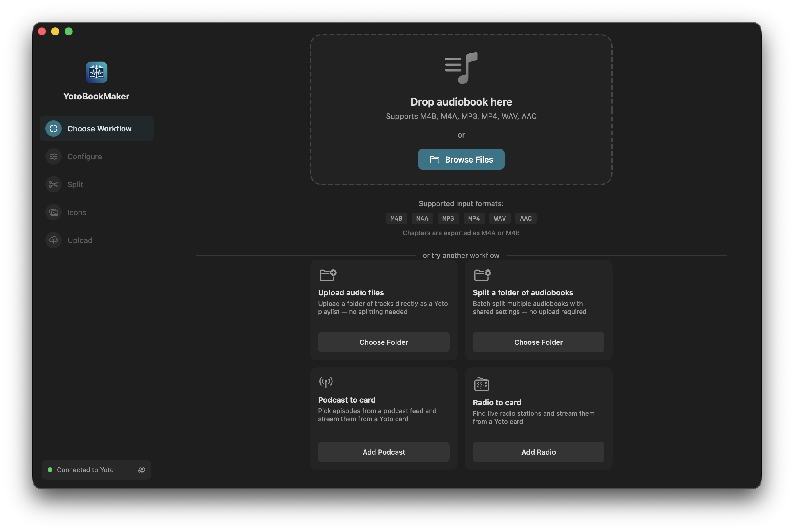

---

### 2 — Configure

Choose how chapters should be detected and pick your export settings.

**Chapter detection methods:**

| Method | When to use |
|---|---|
| **Embedded Metadata** | Best choice — works with most M4B files from Audible, iTunes, Libro.fm, etc. Instant and accurate. |
| **Silence Detection** | For files with no chapter markers. Finds chapter breaks by analyzing gaps in the audio. Not suitable for full-cast productions or books with continuous background music. |
| **JSON Timestamps** | Provide a JSON file with exact start times if you need full manual control. |

**Export options:**

| Setting | Options |
|---|---|
| Format | M4A · M4B · WAV |
| Bitrate | **Original (no re-encode)** (default) · 32 · 48 · 64 · 96 · 128 · 192 kbps |
| Mono | On by default — recommended for Yoto. Auto-enabled and locked when 32 or 48 kbps is selected (Apple's AAC-LC encoder can't produce stereo at those rates). Your prior stereo/mono preference is restored when you pick a higher bitrate. |
| Create subfolder | On by default — creates a `<title>_chapters` folder in your chosen location. Turn off to save files directly in the chosen folder. |

**Yoto has a maximum upload size of 500 MB for Make Your Own Playlist.** Please use the size estimator to find the correct export settings for your book.

The estimated export size is shown before you split. When using **Original** quality, the size matches your source file exactly.

#### Silence detection sensitivity

When using silence detection, choose a sensitivity level that suits your recording:

| Level | Best for |
|---|---|
| **Low** | Expressive narrators with dramatic pauses — conservative, only fires on long quiet gaps (≥ 5s) |
| **Medium** | Most professionally produced audiobooks — balanced default |
| **High** | Recordings with slight background noise or music fades — more sensitive, may produce extra splits |

#### JSON Timestamps format

If you choose **JSON Timestamps**, browse to a `.json` file containing your chapter list. The file is validated immediately on selection — you'll see the chapter count (or a specific error) before you proceed.

Each entry needs a title and a start/end time:

```json
[
  { "title": "Opening Credits", "start": "0:00:00", "end": "0:05:42" },
  { "title": "Chapter 1",       "start": "0:05:42", "end": "0:38:17" },
  { "title": "Chapter 2",       "start": "0:38:17", "end": "1:11:04" }
]
```

Times use `H:MM:SS` or `M:SS` format. Milliseconds are also supported (`start_ms` / `end_ms`). An [example file](example-chapters.json) is included in the repository.

> **Tip:** if you've already split an audiobook using the Metadata method, the `_chapters.json` file it produces can be used directly as input for JSON detection on another file.

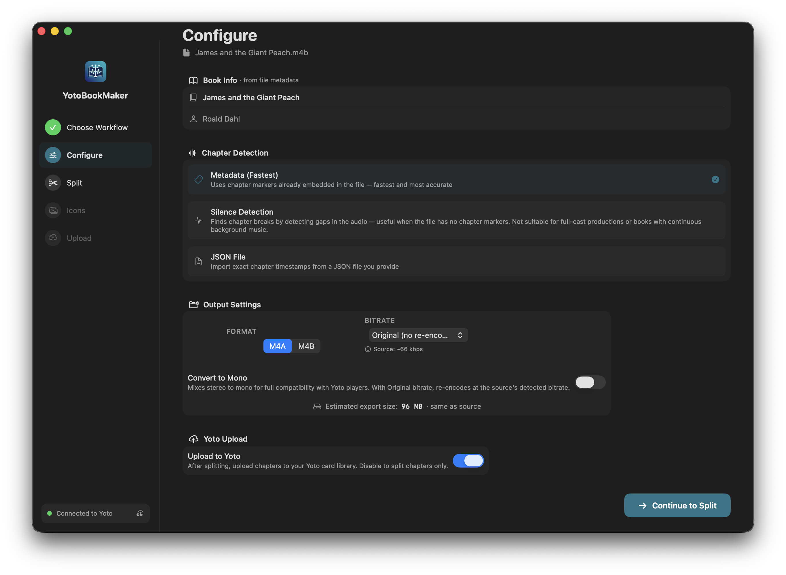

---

### 3 — Split

Click **Start Splitting**. A live log shows what's happening as each chapter is detected and exported, along with an elapsed timer. The chapter list stays on screen after splitting so you can review results, and you can re-run with different settings at any time.

A `<title>_chapters.json` file is written to the output folder automatically — it lists every chapter with its title, timestamps, and file path. This file can be used as JSON Timestamps input if you want to re-split the same book with different export settings.

If the source file contains embedded cover art, a `cover.jpg` is written to the output folder alongside the chapter files.

Once splitting is complete, a **Move Original to Trash** button appears in the results banner if you want to clean up the source file.

> **DRM-protected files:** YotoBookMaker only works with DRM-free audio. Files protected by FairPlay or other DRM are detected automatically and rejected with a clear error — only DRM-free purchases, rips from your own CDs, or public domain recordings can be split.

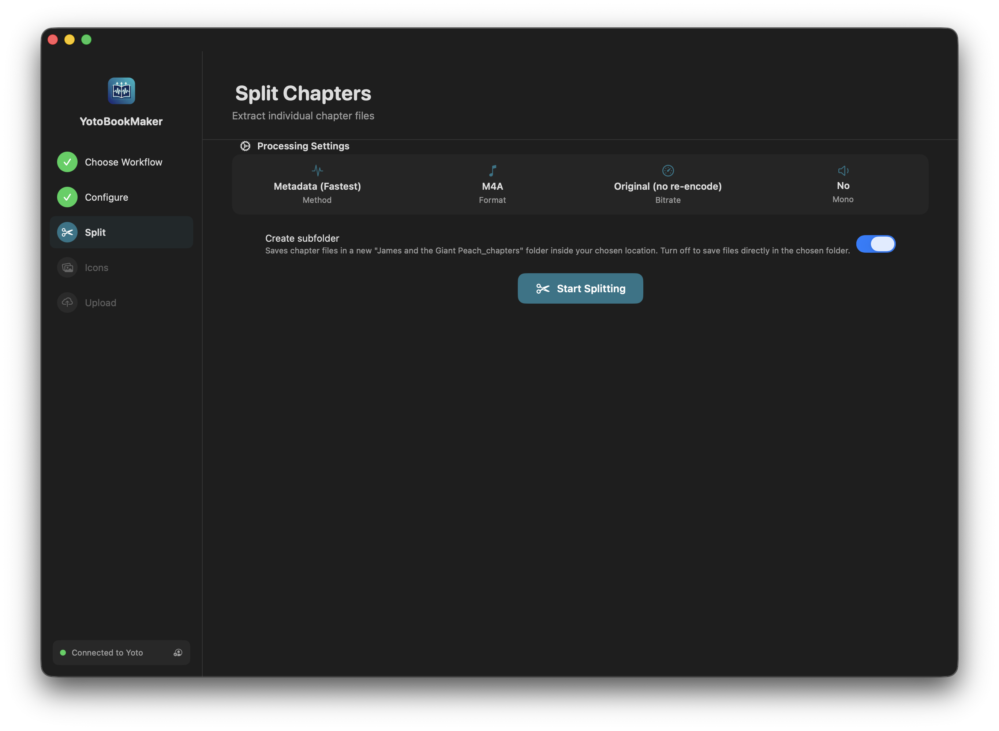

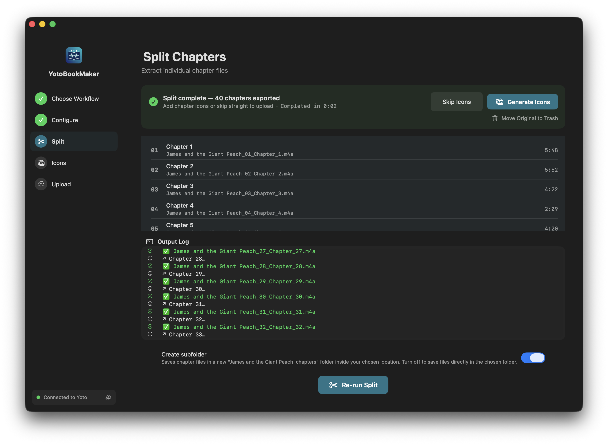

---

### 4 — Icons

Generate a pixel art icon for each chapter, pick an animation, or use your own images and GIFs. See **[Icons](#icons)** for everything this step can do.

---

### 5 — Upload

Optional. Sign in to Yoto and upload the chapters as a ready-to-play playlist. See **[Uploading to Yoto](#uploading-to-yoto)**, including [retrying failed chapters](#retrying-failed-uploads).

[↑ Back to workflows](#workflows)

---

## Playlist workflow

Click **Choose Folder** in the "Upload audio files" section on the welcome screen. Pick any folder of audio files — music, narration, existing chapter splits, or any other content.

Track titles are read from each file's embedded metadata and fall back to the filename if none is found.

### 1 — Playlist Setup

Review the track list loaded from your folder. You can:

- **Edit track titles** — click any title to change it
- **Reorder tracks** — drag rows into the order you want
- **Remove a single track** — hover the row and click the × button that appears, or select it and press Delete
- **Remove multiple tracks** — click to select, then Shift-click or Command-click to extend the selection, then press Delete or click the **Remove N Tracks** button in the toolbar
- **Add more files** — click **Add Files…** to include audio files from other locations
- **Set the playlist name** — used as the title when uploading to Yoto

### 2 — Icons

Same as the audiobook workflow. See **[Icons](#icons)**.

### 3 — Upload

Sign in to Yoto and click **Upload to Yoto**. The app uploads each track's audio and icon, then creates a ready-to-play playlist on your card. See **[Uploading to Yoto](#uploading-to-yoto)**, including [retrying failed tracks](#retrying-failed-uploads).

[↑ Back to workflows](#workflows)

---

## Batch split workflow

Click **Choose Folder** in the "Split a folder of audiobooks" section on the welcome screen. Pick any folder containing M4B, M4A, MP3, or other audio files — every file in the folder will be split using its embedded chapter metadata.

### 1 — Configure

Set shared export settings that apply to every file in the folder:

- **Format** — M4A or M4B
- **Bitrate** — Original (no re-encode) or a specific kbps target
- **Mono** — convert to mono (recommended for Yoto). Auto-enabled and locked when 32 or 48 kbps is selected; your prior stereo/mono preference is restored when you pick a higher bitrate.
- **Search subfolders** — off by default. Turn on to recursively scan nested folders, useful for collections organized as one folder per book (e.g. `Author/Series/Book Title/audio.m4b`). The app's own `*_chapters` output folders are automatically skipped so previously-split books aren't picked up on a rescan.

Chapter detection is always **Embedded Metadata** in batch mode — the fastest and most reliable method. Silence detection and JSON timestamps require per-file configuration and are not available for batch runs.

Each book's chapters are saved in a `<title>_chapters/` subfolder next to the source file. If a book has embedded cover art, a `cover.jpg` is written into that subfolder as well.

### 2 — Batch Split

A list shows every audiobook with a live status indicator:

- **Queued** — waiting to be processed
- **Splitting** — currently processing, with a per-file progress bar
- **Done** — split successfully, with the chapter count
- **Failed** — an error occurred (message shown inline)

Files are processed one at a time in alphabetical order. A **Cancel** button stops the batch after the current file finishes. When the run is complete, a summary shows how many books succeeded and how many failed, with a **Split Another Folder** button to start over.

[↑ Back to workflows](#workflows)

---

## Podcast workflow

Click **Add Podcast** in the "Podcast to card" section on the welcome screen. Episodes stream from the podcast's own servers when they play — nothing is downloaded or uploaded, and there's no size limit to worry about.

### New Card

1. **Find the show** — type a show name to search the Apple Podcasts directory, or paste the podcast's RSS feed link (not its website). Check the author and episode count in the results to pick the official show, then click **Select**.
2. **Pick episodes** — tick the ones you want, or use **Latest 10**, **Latest 30**, **Select All**, or **Clear**. A card holds up to 100 episodes.
3. **Options** — hover or click the ⓘ next to each option for an explanation:
   - **Oldest first on card** — on: the card plays in order from the oldest episode you picked, good for a series. Off: the newest episode comes first, good for news.
   - **Resolve tracking redirects** — follows ad-tracking redirects (Podtrac, Chartable, etc.) and saves the final audio address. Leave it off unless episodes won't play.
4. **Create the card** — the card title comes from the show name (you can edit it), and the show artwork is used as both the card cover and every episode's icon.

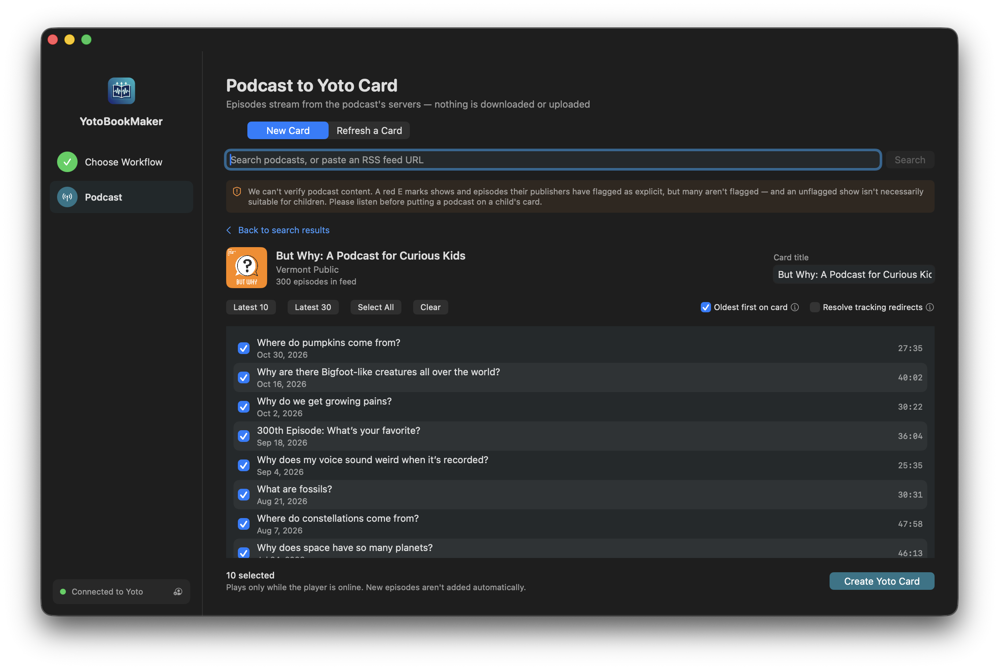

### Refresh a Card

Yoto's website has a Refresh button for podcast cards; this is the app's version of it. Switch to **Refresh a Card** to see your podcast cards that have a saved feed link — every card this app makes, and possibly ones made on Yoto's website.

Click **Refresh** on a card and its episodes are replaced with the newest ones from the feed. Type how many to keep in **Keep the latest N episodes** (1–100, default 30). The card's title and cover stay the same, and the physical card keeps working without relinking.

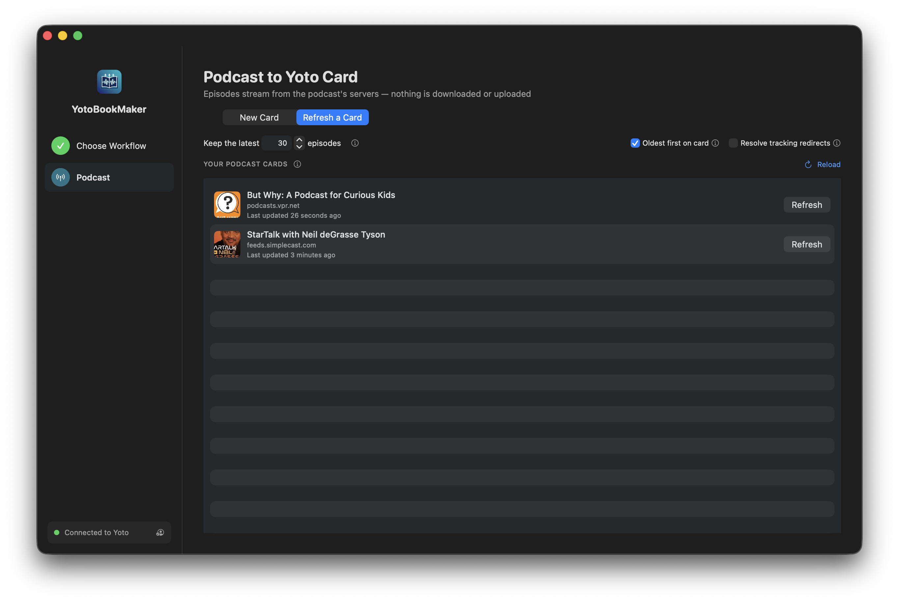

### Explicit content

Shows and episodes that their publisher marks as explicit show a red **E** badge. This relies on the publisher's own labels, and the app can't verify explicit material, so preview a show before giving it to a child.

[↑ Back to workflows](#workflows)

---

## Radio workflow

Click **Add Radio** in the "Radio to card" section on the welcome screen. Stations stream live, so the player needs to be online to play them.

1. **Find stations** — search the [Radio Browser](https://www.radio-browser.info) directory by station name, or paste a stream URL. `.pls` and `.m3u` playlist links work too.
2. **Add them to the card** — click **Add** on each station you want. Secure (`https`) streams are checked as you add them, and you'll see a warning if one looks like it won't play (for example, a link that returns a web page instead of audio). Plain `http` streams can't be checked from the app, so they're added unchecked.
3. **Arrange** — under **On this card**, drag stations to reorder them and click a name to rename it.
4. **Create the card** — the first station's name becomes the card title, and its logo becomes the cover when it's large enough. You can type your own title or pick your own cover; **Use Station Logo** switches back.

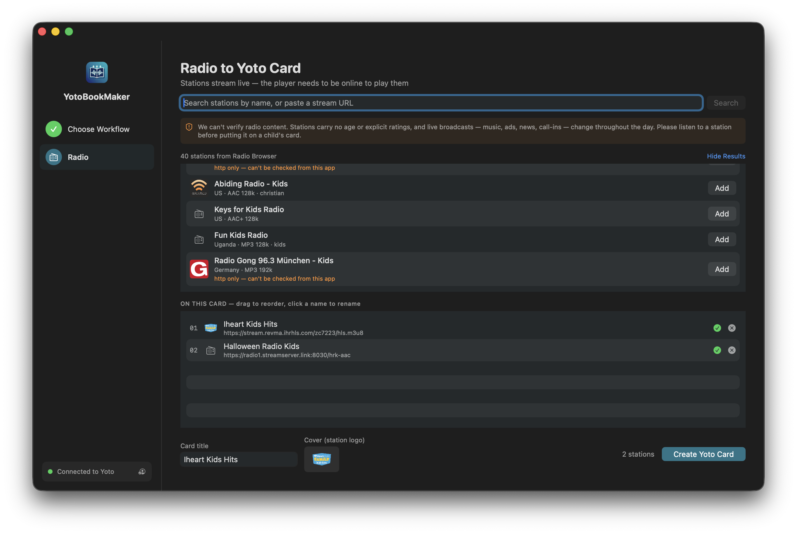

Radio Browser is a community directory with no age ratings, and the app can't verify what a station plays. Listen first before giving a card to a child.

[↑ Back to workflows](#workflows)

---

## Icons

Used by the [audiobook](#audiobook-workflow) and [playlist](#playlist-workflow) workflows. Each chapter or track gets a color-coded pixel art icon, generated entirely on your Mac — no internet needed.

- **Generate All** — auto-generate icons for every chapter
- **Randomize All** — give every chapter a unique random color scheme. You're asked whether you want **All Animated**, **All Still**, or a **Mix**
- **Per-chapter customization** — hover any chapter card to generate, redo, upload your own image, or customize the colors, pattern, and animation
- **Bulk import** — choose a folder of images and they'll be matched to chapters by number in the filename (e.g. `ch-01.png`, `Chapter 22.jpeg`, `ch-07.gif`)

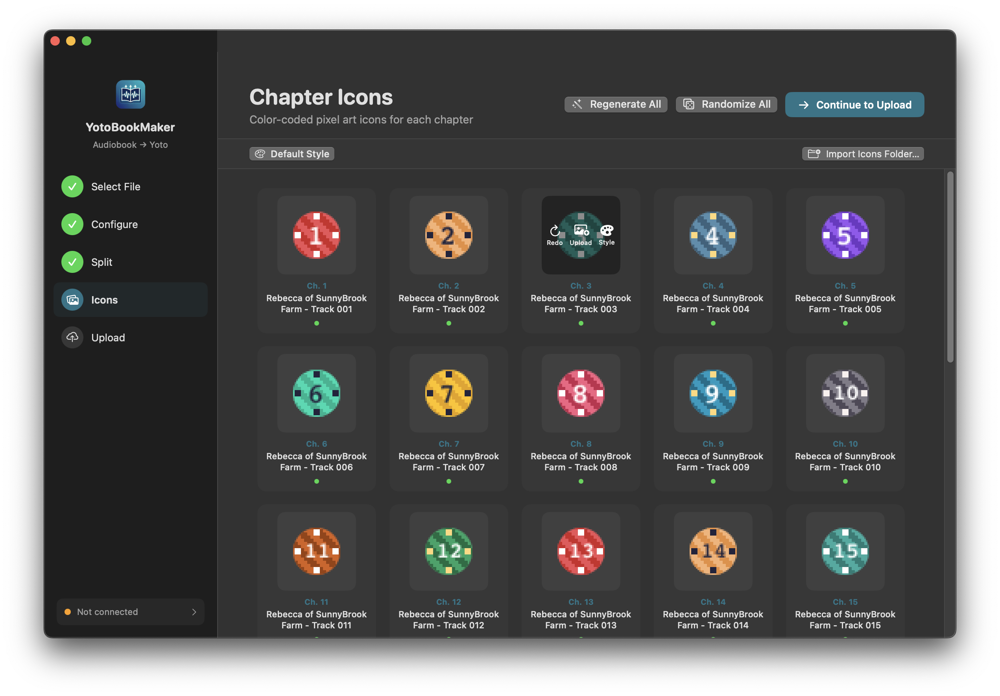

### Animated icons

Generated icons can move on the player. Pick an animation in the icon editor:

| Animation | What it does |
|---|---|
| **None** | A still icon |
| **Scroll** | The background pattern slides diagonally |
| **Orbit** | The accent dots circle around the edge |
| **Twinkle** | The accent dots blink in pairs |
| **Pulse** | The background gently brightens and dims |

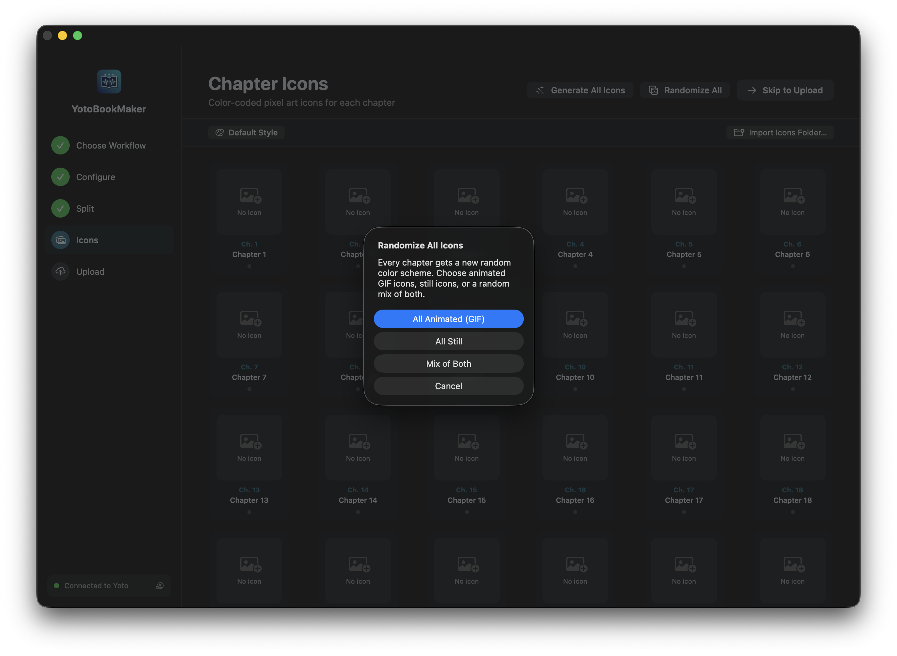

### Your own animated GIFs

You can use your own GIFs as chapter icons, and they stay animated on the player. Yoto only keeps the animation for GIFs that are exactly **16×16 pixels**. If a GIF is a different size, the app offers to **Auto-Resize** it for you (keeping every frame and its timing) or cancel. When you import a folder, you're asked once for all the wrong-size GIFs.

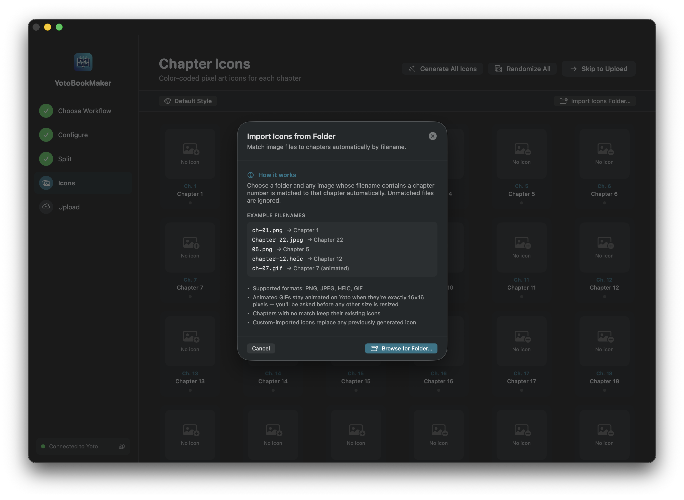

### Chapter numbers

Chapter numbers are drawn with a hand-made pixel font, so they stay sharp and readable on the player's 16×16 screen.

---

## Uploading to Yoto

Used by the [audiobook](#audiobook-workflow) and [playlist](#playlist-workflow) workflows.

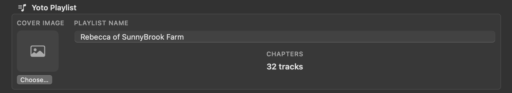

### Signing in and uploading

1. Click **Sign In** (or **Sign In to Yoto**), then **Continue**. Yoto's sign-in page opens in your browser.
2. Sign in, then click **Accept** on Yoto's **Authorize App** page.
3. When the page says **You're signed in**, switch back to the app — it finishes signing in by itself. There's no code to copy, and your password is never entered into the app.
4. Click **Upload to Yoto** and the app handles the rest: uploading audio, icons, and creating a ready-to-play playlist on your card.

> **"This app is not verified by Yoto"** — you'll see this warning on the Authorize App page. It's expected: Yoto only verifies third-party apps once they have an established base of regular users, so new apps like this one show it for now. YotoBookMaker asks only to manage your Make Your Own content and to stay signed in. The page also lists "account details, including email address, region and language" — YotoBookMaker doesn't ask for these, and never reads or stores them.

Your sign-in is saved securely in the macOS Keychain so you only need to do it once.

Sign-in briefly uses port 8787 on your Mac to receive the reply from Yoto's page. If another app is using that port, the app asks you to close it and try again.

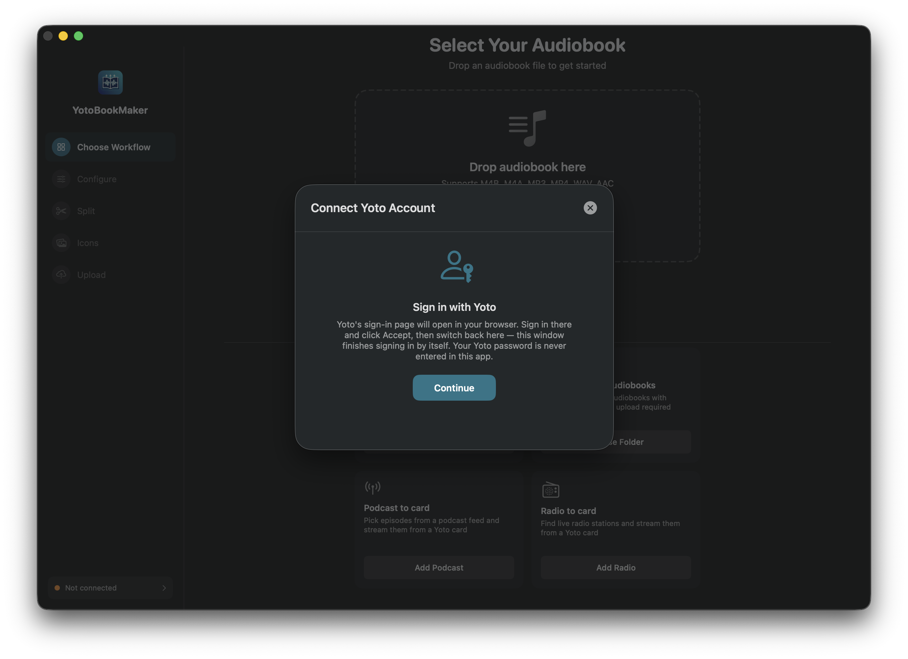
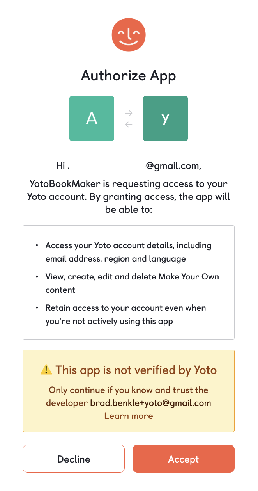
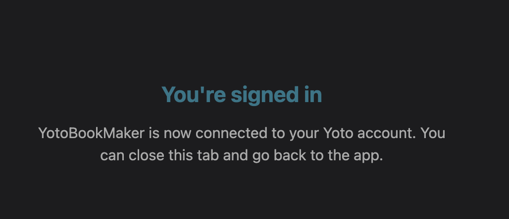
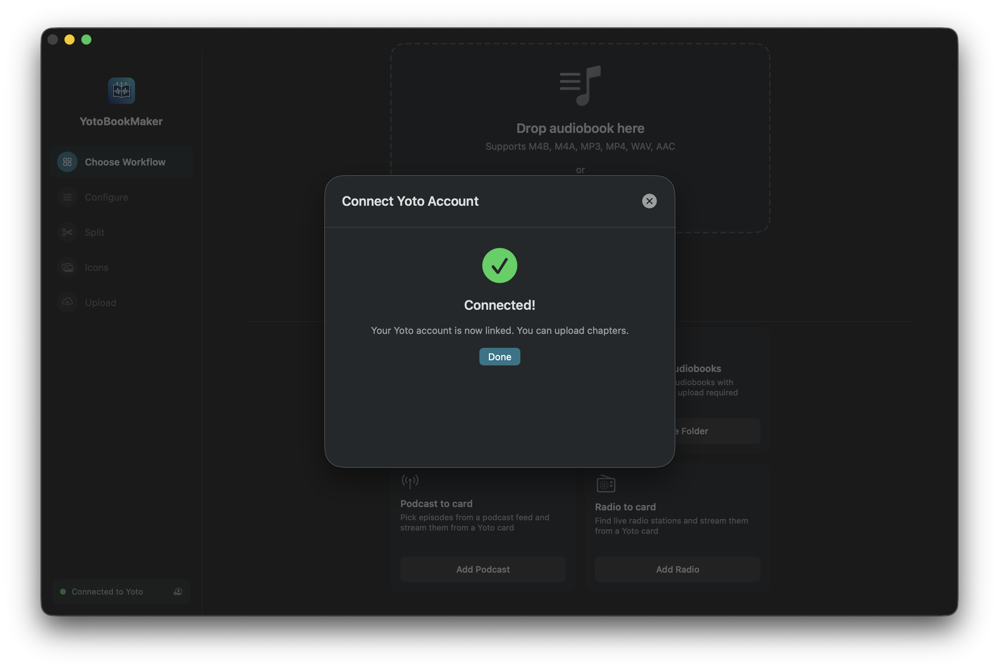
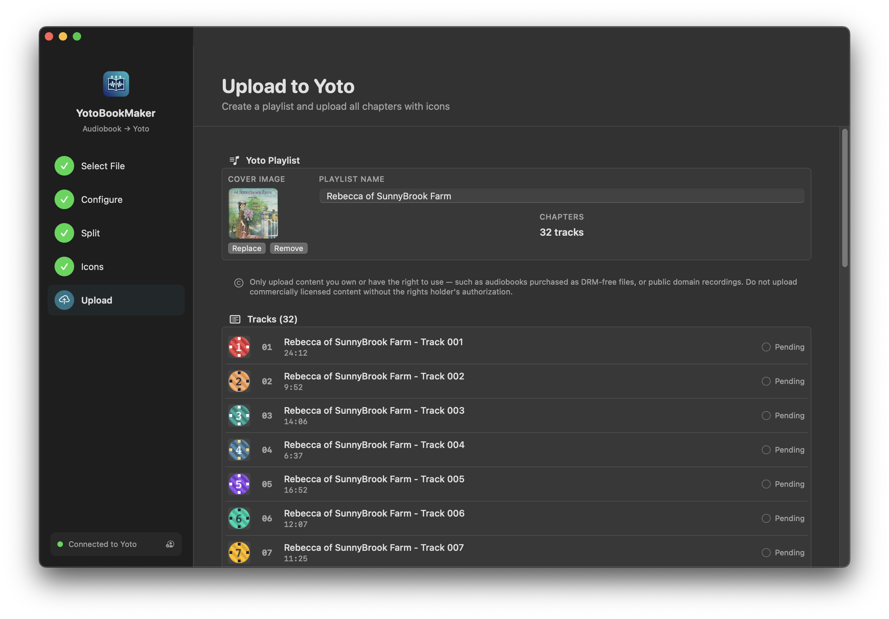

### Retrying failed uploads

If some chapters fail to upload, you don't have to start over. Chapters that already made it to Yoto are remembered, so only the failed ones are sent again, and they're added to the card from the first attempt instead of making a second card. You can:

- click **Retry N Failed Chapters** to re-send every failed chapter
- click **Retry** on a single failed chapter to re-send just that one
- click **Upload N Remaining** after cancelling, to pick up where you stopped
- click **Create Card** if every chapter uploaded but creating the card itself failed

Retries only remember chapters for the current project. If you quit the app or start a new project, the next upload sends everything again.

---

## CLI tool (yotosplit)

YotoBookMaker includes a command-line tool for splitting audiobooks from scripts or automation pipelines — no UI needed.

**Install once** via **Help → Install CLI Tool…** in the app, then use it from any terminal:

```bash
# Split a single file using embedded chapter metadata (default)
yotosplit --input ~/audiobooks/Book.m4b

# Silence detection with custom threshold
yotosplit --input ~/audiobooks/Book.m4b --method silence --min-silence 2.5

# Re-encode to 64 kbps mono, save directly in the output folder
yotosplit --input ~/audiobooks/Book.m4b --output ~/Desktop/chapters --bitrate 64k

# Move the original to Trash after a successful split
yotosplit --input ~/audiobooks/Book.m4b --trash

# Split every audiobook in a folder (embedded metadata, shared settings)
yotosplit --folder ~/audiobooks --bitrate 64k --mono
```

Chapter list is printed to stdout (tab-separated: number, title, path) — easy to pipe into other tools. In folder mode, each line is prefixed with the source filename: `<filename>\t<number>\t<title>\t<path>`. Progress and log messages go to stderr. Exit code 0 on success, 1 on error.

A `<title>_chapters.json` file is always written to the output directory alongside the audio files. If the source file contains embedded cover art, a `cover.jpg` is written there as well.

```
USAGE: yotosplit (--input <file> | --folder <path>)
                 [--output <output>] [--method <method>]
                 [--format <format>] [--bitrate <bitrate>]
                 [--mono] [--no-mono]
                 [--silence-threshold <dBFS>] [--min-silence <seconds>]
                 [--json-file <path>] [--trash]
```

`--folder` is mutually exclusive with `--input`. In folder mode, `--method` is ignored — embedded metadata is always used.

Run `yotosplit --help` for full option descriptions.

---

## Updates

The app checks for new releases automatically on launch. When an update is available, a badge appears in the sidebar with a link to the release page.

---

## Privacy

| | |
|---|---|
| Audio splitting | Stays entirely on your Mac |
| Icon generation | Stays entirely on your Mac |
| Speech recognition (used during silence detection) | On-device. Only falls back to Apple's servers if the on-device model is unavailable — this is logged if it happens |
| Update check | Sends a read-only request to the GitHub Releases API — no personal data |
| Yoto sign-in | Happens on Yoto's own page in your browser. The app only keeps the sign-in tokens, in your Keychain — never your password, email, or account details |
| Upload | Sent to Yoto's servers — only when you click Upload |
| Podcast search | Your search words are sent to Apple's public iTunes Search API |
| Podcast feeds and artwork | Fetched from the podcast's own host |
| Radio search, stream checks, and logos | Your search words go to the Radio Browser directory; stream checks and logos are fetched from each station's servers |

No analytics. No telemetry. No accounts other than Yoto, and nothing about you is sent with searches.

---

## Disclaimer

YotoBookMaker is an independent, community-built tool. It is **not affiliated with, endorsed by, or supported by Yoto Limited**. Yoto, the Yoto logo, and Yoto Player are trademarks of Yoto Limited.

Only upload audio content you own or have the legal right to use — such as DRM-free audiobook purchases or public domain recordings. Do not upload commercially licensed content without the rights holder's authorization.

---

## License

MIT — see [LICENSE](LICENSE) for details.
